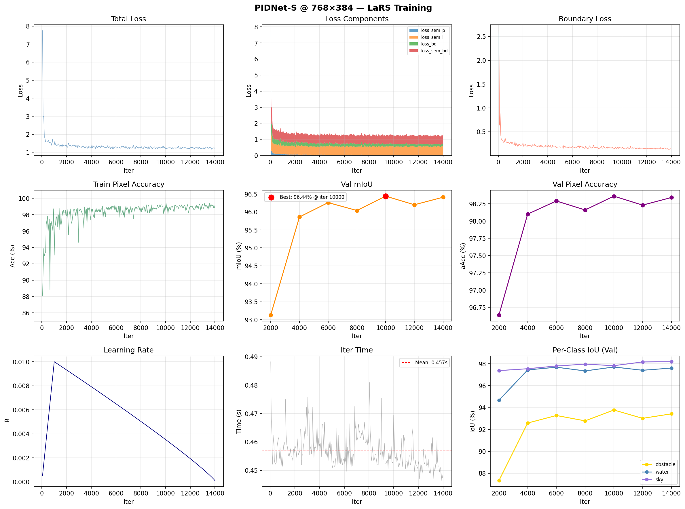

# PIDNet-S @ 768×384 — Fun Experiment Report

**Date:** 2026-02-23
**Model:** PIDNet-S (3-branch P/I/D architecture, ImageNet pretrained)
**Dataset:** LaRS (3-class maritime: obstacle=0, water=1, sky=2)
**Training resolution:** 768×384 (W×H) — native target resolution
**Hardware:** NVIDIA RTX 3050 4 GB (container)
**Environment:** conda env `pidnet` — Python 3.11, PyTorch 2.1.2+cu121, mmcv 2.1.0, mmseg 1.2.2

---

## Motivation

Following the STDC2 fun experiment (96.54% mIoU best at iter 10000), this experiment
tests PIDNet-S — a newer architecture (CVPR 2023) with half the parameters (7.7M vs 14M)
and explicit boundary supervision via a dedicated D-branch and BoundaryLoss.
PIDNet-S outperforms STDC2 on Cityscapes (78.74% vs ~76.8% mIoU) so the question is
whether that advantage transfers to the LaRS 3-class maritime domain.

| Variant | mIoU (val) |
|---|---|
| STDC2 768×384 (this repo) | 95.54% |
| PIDNet-S 768×384 (this experiment) | **96.44%** |

---

## Training Setup

| Parameter | Value |
|---|---|
| Config | `configs/pidnets_768x384_lars_fun.py` |
| Batch size | 5 (hardware ceiling; bs=16 OOMs) |
| VRAM usage | ~3302 MiB / ~3768 MiB usable |
| Avg iter time | ~0.490 s/iter |
| Total iters | 14,000 (~80 epochs) |
| Total training time | ~1.91 hrs |
| Optimizer | SGD, lr=0.01, momentum=0.9, wd=5e-4 |
| LR schedule | LinearLR warmup (1000 iters) + PolyLR (power=0.9, min_lr=1e-4) |
| Train pipeline | RandomResize (0.5–2.0×) + RandomCrop + HFlip + PhotoMetricDistortion + GenerateEdge |
| Test pipeline | Fixed resize to 768×384 (keep_ratio=False) |
| Loss | CE (w=0.4) + OhemCE (w=1.0) + BoundaryLoss (w=20.0) + OhemCE (w=1.0) |

---

## Validation Results (all evals)

| Iter | mIoU | aAcc | IoU obstacle | IoU water | IoU sky | Best? |
|---|---|---|---|---|---|---|
| 2,000  | 93.13% | 96.64% | 87.33% | 94.67% | 97.38% | |
| 4,000  | 95.86% | 98.10% | 92.59% | 97.44% | 97.55% | |
| 6,000  | 96.26% | 98.29% | 93.28% | 97.69% | 97.80% | |
| 8,000  | 96.04% | 98.16% | 92.79% | 97.35% | 97.97% | |
| 10,000 | **96.44%** | **98.36%** | **93.78%** | 97.71% | 97.83% | ⭐ |
| 12,000 | 96.20% | 98.23% | 93.02% | 97.41% | 98.17% | |
| 14,000 | 96.41% | 98.34% | 93.43% | 97.61% | 98.19% | |

**Best checkpoint:** `best_mIoU_iter_10000.pth` (mIoU 96.44%)

---

## Training Curves

---

## Convergence Analysis

### Learning phases

The model went through three distinct phases:

**Phase 1 — Rapid learning (iter 0–4000):**
mIoU jumped from 93.13% to 95.86% (+2.73%), driven by the pretrained backbone adapting
to the LaRS domain. The model learned the dominant patterns (large water and sky regions)
very quickly. Loss dropped from ~7.75 to ~1.24 over this period.

**Phase 2 — Deceleration (iter 4000–6000):**
Improvement slowed sharply to +0.40% (2000→4000 was +2.73%). The model was mining
harder examples — primarily obstacle boundaries, where the BoundaryLoss provides the
most targeted signal. Train pixel accuracy reached ~99%, indicating near-saturation of
the training set.

**Phase 3 — Plateau (iter 6000–14000):**
mIoU oscillated in a ±0.40% band around 96.25%: 96.26% → 96.04% → 96.44% → 96.20% → 96.41%.
The best checkpoint (iter 10000, 96.44%) coincides with LR decaying close to its minimum
(1e-4), which stabilizes weights and reduces noise in val performance — the same mechanism
observed in STDC2.

### Is this overfitting?

No. Overfitting is characterised by a sustained decline in val performance while train
performance remains high. What we observe is a flat oscillation with no net downward trend:
the val mIoU at iter 14000 (96.41%) is nearly identical to iter 6000 (96.26%). The train-val
gap (train acc ~99% vs val mIoU 96.44%) is stable and not widening.

The model has reached the accuracy ceiling of this setup — limited by dataset size
(2,607 training images), not by architecture capacity. Extending training further on the
same data would continue the plateau without meaningful improvement.

### PIDNet-S vs STDC2

| Metric | STDC2 (best) | PIDNet-S (best) | Δ |
|---|---|---|---|
| mIoU | 95.54% | 96.44% | +0.90% |
| aAcc | 97.96% | 98.36% | +0.40% |
| IoU obstacle | 91.94% | 93.78% | +1.84% |
| IoU water | 97.27% | 97.71% | +0.44% |
| IoU sky | 97.41% | 97.83% | +0.42% |
| Params | 14M | 7.7M | −6.3M |

The obstacle class shows the largest improvement (+1.84% IoU) — consistent with
PIDNet's explicit boundary supervision targeting the hardest class. PIDNet-S achieves
this with half the parameters, confirming its Cityscapes advantage translates to LaRS.

The overall +0.90% mIoU is a real improvement but should be treated as a proxy.
The challenge metric (obstacle detection F1 after INT8 quantization on the RVC4 device)
may show a different relative margin.

---

## ONNX Export

| Property | Value |
|---|---|
| File | `pidnets_768x384.onnx` |
| Checkpoint | `best_mIoU_iter_10000.pth` |
| Input name | `input` |
| Input shape | `float32[1, 3, 384, 768]` (NCHW) |
| Output name | `output` |
| Output shape | `float32[1, 3, 384, 768]` (logits) |
| Opset | 11 |
| PyTorch vs ONNX max diff | 7.39e-06 ✅ |

Output is raw **logits**. Take `argmax` over dim=1 for the segmentation map.
Class indices: 0=obstacle, 1=water, 2=sky.
Palette: obstacle=(247,195,37) yellow, water=(41,167,224) blue, sky=(90,75,164) purple.

---

## Key Takeaways

- PIDNet-S outperforms STDC2 at 768×384 by +0.90% mIoU with half the parameters.
  The advantage is most pronounced on the obstacle class (+1.84% IoU), directly
  attributable to boundary-aware training via the D-branch and BoundaryLoss.
- The model converged rapidly (phase 1 complete by iter ~4000) and plateaued by iter
  6000. The best checkpoint at iter 10000 benefits from LR stabilization rather than
  continued learning.
- No overfitting observed within the 14,000-iter window. The accuracy ceiling is the
  dataset size (2,607 images), not architecture capacity.
- The comparison with STDC2 is not fully apples-to-apples: PIDNet saw more total samples
  (14000×15=210k vs 12000×12=144k) due to matching wall-clock time rather than training
  budget. A controlled comparison with equal samples would be needed to isolate the
  architecture effect.
- For Phase 1, PIDNet-S is the strongest qualifying candidate identified so far.
  Next steps: submit ONNX to challenge server for actual F1 measurement, and run
  SegNeXt-T experiment for further comparison.
